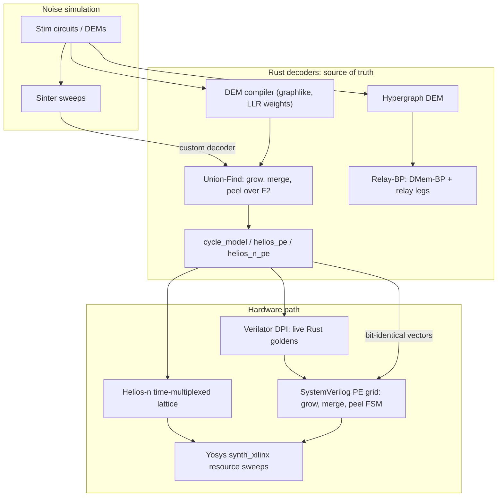
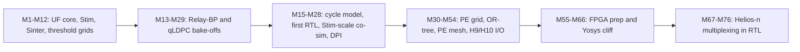

<div align="center">

# Aether-Decoders

### Real-time quantum error correction decoding, from proof-checked software to FPGA-ready RTL

**Integer Union-Find** for surface codes &nbsp;·&nbsp; **Relay-BP** for qLDPC codes &nbsp;·&nbsp; **SystemVerilog PE grids** co-simulated bit-for-bit against Rust

[](https://github.com/Divyansh151005/Aether-Decoders/actions/workflows/ci.yml)
[](https://www.rust-lang.org/)
[](rtl)
[](https://github.com/quantumlib/Stim)
[](Docs/Progress)
[](LICENSE)

</div>

---

A fault-tolerant quantum computer has to read out error syndromes, decode them, and send corrections back within a **microsecond-scale budget**, round after round, or the logical qubits are lost. Aether-Decoders builds that decoder end to end:

1. **Software first.** A correct integer Union-Find decoder and a Relay-BP decoder in Rust, benchmarked on Stim circuits against PyMatching and BP+OSD.
2. **Then hardware.** The same algorithms as SystemVerilog processing-element (PE) grids, checked against the Rust model **bit for bit**, in the style of the Helios FPGA decoder.
3. **Then silicon budgets.** Yosys resource sweeps from single PEs up to Stim-scale graphs, and a time-multiplexed **Helios-n** design for graphs that are too large to fit flat.

Every claim in this repository is tied to a test, a co-simulation log, or a CSV in [`results/`](results), and every milestone is recorded in [`Docs/Progress`](Docs/Progress).

<div align="center">

| 76 | 28 | 46 | 29 + 29 | 54 |
|:-:|:-:|:-:|:-:|:-:|
| **milestones** | **Rust tests** | **result CSVs** | **RTL modules + testbenches** | **research notes** |

</div>

## Contents

- [Architecture](#architecture)
- [Design rules](#design-rules)
- [Results](#results)
- [Quickstart](#quickstart)
- [Milestone journey](#milestone-journey)
- [Repository layout](#repository-layout)
- [Research notes](#research-notes)
- [Roadmap](#roadmap)
- [References](#references)

## Architecture



| Layer | What it is | Where |
|---|---|---|
| **UF core** | Flat struct-of-arrays graph, DSU with union-by-size, discrete cluster growth, peeling over F2. No `petgraph`. | `src/{graph,dsu,engine,peeling,weights}.rs` |
| **Stim pipeline** | DEM to UF graph compiler, persistent `decode_shots` process, Sinter custom decoder, threshold sweeps vs PyMatching | `src/compiled.rs`, `python/aether_decoders/`, `scripts/threshold_sweep.py` |
| **Relay-BP** | Min-sum DMem-BP with per-node (possibly negative) memory strength and relay legs, after Müller et al. | `src/relay_bp.rs`, `src/relay_compiled.rs` |
| **Cycle models** | Cycle-accurate UF model plus Helios-style PE and Helios-n multiplexed PE models used as RTL oracles | `src/{cycle_model,helios_pe,helios_n_pe}.rs` |
| **RTL** | Grow/merge, OR-tree, per-PE mesh, LUTRAM dual context, multi-cycle peel FSM, syndrome ring, observable egress, Helios-n lattice | `rtl/` |
| **Co-sim** | Icarus and Verilator testbenches fed by generated vectors, plus a Verilator DPI bridge that calls Rust live | `rtl/tb_*.sv`, `dpi/`, `scripts/*_sim.sh` |
| **FPGA prep** | Staged S0 to S4 Yosys `synth_xilinx` runs, bring-up gates, Vivado S0 Tcl/XDC | `fpga/`, `Docs/Fpga_Bringup_Prep` |

## Design rules

These were each learned from a measured bug or mismatch, and they are kept identical in software and RTL. They are not simplified for hardware.

- **Active cluster** = odd defect parity **and** not touching a virtual boundary.
- **Peel from the frozen `syndrome[]`**, never from DSU-mutated parity.
- **Union-by-size**, and skip growth along edges whose endpoints already share a root.
- **One unique virtual boundary vertex per degree-1 DEM error**, so opposite boundaries never get stitched together.
- **Root a boundary-touching cluster at one boundary** and peel every other leaf, including extra virtual boundaries.
- **Circuit Y-faults** stay as `^`-separated pieces and are split, so every piece is degree 2 or less.

The full list of corrected mistakes, with the evidence for each, is in the *Mistakes and corrections* table of [`Docs/Progress`](Docs/Progress).

## Results

All numbers below are copied from CSVs in [`results/`](results). Logical error rates come with shot counts, and decoder comparisons are only made on matched shots with **Wilson 95% intervals**. No threshold is fitted.

### Surface code: Union-Find vs MWPM (M12)

Circuit-level `rotated_memory_z`, rounds = d, 1200 matched shots per row, Stim depolarizing noise on gates, data, measurement and reset. Source: [`threshold_circuit_m12.csv`](results/threshold_circuit_m12.csv).

| d | p | UF errors / LER [95% CI] | PyMatching errors / LER [95% CI] |
|:-:|:-:|---|---|
| 3 | 0.003 | 13 / 0.0108 [0.0063, 0.0185] | 10 / 0.0083 [0.0045, 0.0153] |
| 5 | 0.003 | 5 / 0.0042 [0.0018, 0.0097] | 6 / 0.0050 [0.0023, 0.0109] |
| 7 | 0.003 | 1 / 0.0008 [0.0001, 0.0047] | 1 / 0.0008 [0.0001, 0.0047] |
| 3 | 0.006 | 33 / 0.0275 [0.0197, 0.0384] | 17 / 0.0142 [0.0089, 0.0226] |
| 7 | 0.006 | 20 / 0.0167 [0.0108, 0.0256] | 26 / 0.0217 [0.0148, 0.0316] |

At p = 0.003, the UF intervals for d = 7 and d = 3 are **disjoint**, so distance suppression is visible at that point. UF tracks MWPM closely, which is the expected heuristic gap. The phenomenological grid after the M10 peel fix is in [`threshold_phenom_m10.csv`](results/threshold_phenom_m10.csv). Across 12 × 400 shots up to d = 7, UF finished every decode with **0 aborts** (M51, M54).

### qLDPC: Relay-BP vs BP+OSD on IBM gross `[[144,12,12]]`

The comparison is against `ldpc` BP+OSD-CS10 on IBM's published bivariate-bicycle Stim circuits (d = 12, 12 rounds).

| Run | p | Shots | Relay-BP errors | BP+OSD errors | Wilson verdict |
|---|:-:|:-:|:-:|:-:|---|
| M21 | 0.006 | 50 | 26 | 30 | overlap |
| M27 (seed 1) | 0.005 | 400 | 72 | 115 | disjoint |
| M29 (seed 2) | 0.005 | 400 | 92 | 115 | overlap |
| M76 pooled (M27 + M29) | 0.005 | 800 | 164 | 230 | disjoint |

Relay-BP has fewer errors at every matched point, but the intervals separate at **one** p only, and the BP+OSD count was identical in both seeds. That should be re-run before the pooled result is cited. Gains are problem-dependent, as Müller et al. note.

### Hardware co-simulation: RTL ≡ Rust, bit for bit

| Milestone | Graph | Check | Result |
|---|---|---|:-:|
| M19 | 8 Blueprint graphs | grow → merge → peel RTL vs `decode_cosim` | **8/8** |
| M22 / M45 | phenom d=3 r=3, V=72 E=94 | Stim shots, PE-mesh grow → peel | **4/4** |
| M23 | phenom d=5 r=5, V=272 E=518 | Icarus + Verilator | **2/2 + 2/2** |
| M24 / M47 | circuit d=3 r=3, V=392 E=556 | PE-mesh grow → peel, Verilator | **2/2** |
| M26 / M28 | Blueprint and V=392 | Verilator DPI calling live Rust goldens | **8/8, 2/2** |
| M53 | phenom Stim | syndrome ring → peel → observable XOR egress | **4/4** |
| M72 | phenom r=3, Helios-n 16 parts / 7 PEs | multiplexed Stage D peel vs `decode_cosim` | **16/16** |
| M74 | same map, SystemVerilog schedule RTL | grow → peel vs Helios-n oracle (3 425 380 clk, 34 clk/iter) | **16/16** |
| M76 | circuit V=392, 165 parts / 16 PEs | Helios-n map vs oracle | **16/16** |

### FPGA resources (Yosys `synth_xilinx`, pre place-and-route)

| Design | LUT | FF | Notes |
|---|--:|--:|---|
| OR-tree (S0) | 14 | | M56 |
| H10 syndrome ring (S0) | 30 | 42 | M56 |
| Helios-2 micro PE (S2) | 410 | | M58, BRAM = 0 |
| Multi-cycle peel FSM | 9 453 | 1 405 | M60 |
| S1 Blueprint grow → peel | 13 364 | 1 618 | M62 |
| Peel N=16 | 18 023 | 9 509 | M63 |
| Flat grow N=16 | 138 502 | | M66, last size that finishes |
| S3 phenom grow → peel (V=16) | 153 509 | 10 284 | M64 |
| Flat grow N=24 / N=32 / V=392 | timeout | | M65, M66: the flat-mesh cliff |
| Observable egress (synthesizable) | 3 645 | | M75 |
| **Helios-n lattice, N_PHYS = 7** | **12 576** | **384** | **M74**, plus 180 RAM32M16 |

The flat PE mesh stops synthesizing past N = 16, which is why the project moved to **Helios-n** time multiplexing (M67 to M76). These are Yosys estimates. Vivado utilization and timing on the target part are the next milestone.

## Quickstart

### Prerequisites

| Tool | Needed for |
|---|---|
| Rust (stable, 2021 edition) | everything |
| Python 3.10+ with `pip install -r python/requirements.txt` (Stim, Sinter, PyMatching, `ldpc`) | Stim sweeps and bake-offs |
| [Icarus Verilog](https://github.com/steveicarus/iverilog) | Blueprint and Stim RTL co-sim |
| [Verilator](https://www.veripool.org/verilator/) 5.x | large co-sims, DPI, Helios-n RTL |
| [Yosys](https://github.com/YosysHQ/yosys) | FPGA resource scripts in `fpga/` |

### Build and test

```bash
git clone https://github.com/Divyansh151005/Aether-Decoders.git
cd Aether-Decoders
cargo test --workspace --release        # 17 unit + 11 integration tests
```

### Decode Stim shots with Union-Find

```bash
cargo build --release --bin decode_shots
# dem.json: graphlike DEM from python/aether_decoders/dem.py
# shots.txt: one 0/1 detector string per line
./target/release/decode_shots dem.json shots.txt   # prints observable bits per shot
```

### Use it as a Sinter decoder

```python
# run with PYTHONPATH=python so Sinter workers can import the decoder
import sinter
from aether_decoders import AetherUfDecoder

stats = sinter.collect(
    tasks=tasks,                          # list[sinter.Task] built from Stim circuits
    decoders=["aether_uf"],
    custom_decoders={"aether_uf": AetherUfDecoder()},
    num_workers=2,
    max_shots=1200,
)
```

```bash
PYTHONPATH=python python3 scripts/stim_surface_code_smoke.py   # UF vs PyMatching smoke
PYTHONPATH=python python3 scripts/threshold_sweep.py --noise circuit --distances 3,5,7 \
  --ps 0.001,0.002,0.003 --max-shots 1200 --max-errors 1000000000 --workers 2 --out results/my_sweep.csv
```

### Relay-BP vs BP+OSD on bivariate-bicycle codes

```bash
python3 scripts/relay_bb_bakeoff.py --help   # circuits live in testdata/bicycle_bivariate/
```

### Hardware co-simulation

```bash
./scripts/rtl_decode_sim.sh         # Icarus: grow -> merge -> peel vs Rust goldens (8/8)
./scripts/pe_mesh_stim_r3_sim.sh    # PE-mesh on a Stim phenom d=3 r=3 graph
./scripts/dpi_rtl_cosim.sh          # Verilator DPI with live Rust goldens
./scripts/helios_n_rtl_m74_sim.sh   # Helios-n schedule RTL vs oracle (16/16), about 2 min
```

> [!NOTE]
> Write new measurements to new CSV names. Files in `results/` are cited by milestone and must not be overwritten.

## Milestone journey



| Phase | Milestones | Highlights |
|---|---|---|
| **Union-Find in software** | M1 to M12 | SoA UF core, peeling over F2, Stim DEM compiler, Sinter adapter, persistent decode process, the boundary-peel bug fix (M10), and a 1200-shot circuit grid with Wilson intervals |
| **qLDPC decoding** | M13, M14, M21, M25, M27, M29 | Relay-BP from Müller et al., IBM bivariate-bicycle circuits, matched-shot bake-offs vs BP+OSD with seed replication |
| **Bit-identical hardware model** | M15 to M28 | Cycle-accurate UF model, Helios-style PE, first SystemVerilog, peel FSM, Stim graphs up to V=392, Verilator DPI |
| **PE grid architecture** | M30 to M54 | OR-tree completion detection, per-PE neighbor ports, edge-list mesh, LUTRAM dual context, syndrome ring and observable egress, abort-rate gates |
| **FPGA prep** | M55 to M66 | Bring-up gates, S0 to S4 Yosys stages, multi-cycle peel, and the flat-mesh synthesis cliff past N=16 |
| **Helios-n** | M67 to M76 | Partitioning, PE coloring under colocation, multiplexed grow and peel oracles, SystemVerilog schedule RTL (16/16), circuit V=392 map, synthesizable egress, Vivado S0 scripts |

The complete table with the evidence for every milestone is in [`Docs/Progress`](Docs/Progress).

## Repository layout

```text
Aether-Decoders/
├── src/                 Rust library (aether_decoders)
│   ├── graph.rs dsu.rs engine.rs peeling.rs weights.rs    Union-Find core
│   ├── compiled.rs                                       Stim DEM -> UF graph
│   ├── relay_bp.rs relay_compiled.rs                     Relay-BP
│   ├── cycle_model.rs helios_pe.rs helios_n_pe.rs        cycle-accurate hardware models
│   ├── blueprint_rtl.rs stim_rtl.rs                      RTL vector generation
│   └── bin/             decode_shots, decode_relay_shots, gen_*_vectors, *_cosim tools
├── dpi/                 aether_uf_dpi: Verilator DPI bridge (live Rust goldens)
├── rtl/                 SystemVerilog modules, testbenches, generated vectors in rtl/gen/
├── fpga/                Yosys scale runs, S0 Vivado Tcl/XDC
├── python/              DEM helpers and the Sinter custom decoder
├── scripts/             Stim harnesses, sweeps, bake-offs, sim and synth runners
├── testdata/            IBM bivariate-bicycle Stim circuits
├── results/             cited measurement CSVs (do not overwrite)
├── tests/               integration tests
└── Docs/                Progress log, hardware mapping, per-milestone research notes
```

| Binary | Purpose |
|---|---|
| `decode_shots` | Union-Find decode of 0/1 detector shots against a compiled DEM |
| `decode_relay_shots` | Relay-BP decode on hypergraph DEMs |
| `gen_rtl_vectors`, `gen_stim_rtl_vectors`, `gen_helios_n_rtl_vectors` | Golden vectors for RTL testbenches |
| `helios_n_grow_cosim`, `helios_n_decode_cosim` | Helios-n multiplexed oracles vs the flat model |
| `count_uf_decode_errors` | Abort and decode-error rate measurement |

## Research notes

[`Docs/`](Docs) holds a note for nearly every milestone. Good starting points:

| Note | Read it for |
|---|---|
| [`Progress`](Docs/Progress) | Source of truth: milestone table, results, corrected mistakes, next steps |
| [`Blueprint`](Docs/Blueprint), [`Peeling_algo_example`](Docs/Peeling_algo_example) | The UF algorithm with a worked peeling example |
| [`Equations_Theory`](Docs/Equations_Theory), [`Maths_involved`](Docs/Maths_involved) | Parity checks, syndromes, and decoder math |
| [`Hardware_Mapping`](Docs/Hardware_Mapping) | How the SoA software maps onto Helios-style PEs and memories |
| [`Fpga_Bringup_Prep`](Docs/Fpga_Bringup_Prep) | S0 to S5 bring-up stages and G1 to G6 gates |
| [`Helios_n_Multiplex_M67`](Docs/Helios_n_Multiplex_M67) to [`Helios_n_Circuit_M76`](Docs/Helios_n_Circuit_M76) | The time-multiplexed design, from partitioning to circuit-scale maps |
| [`Overview`](Docs/Overview) | The original vision document. Parts are superseded; see the banner at its top |

## Roadmap

- [x] Correct integer Union-Find with Stim, Sinter, and PyMatching comparisons
- [x] Relay-BP with matched-shot qLDPC bake-offs
- [x] Bit-identical RTL co-simulation up to circuit-level V=392 graphs
- [x] Yosys resource sweeps and the flat-mesh cliff
- [x] Helios-n multiplexed RTL matching its oracle 16/16
- [ ] Vivado S0 on a Linux host: utilization and WNS, then post-synth simulation of the S3 host top
- [ ] Synthesizable Helios-n merge, required before a full-core Vivado run
- [ ] More efficient circuit-scale Helios-n mapping than M76's 165 parts
- [ ] Re-run the M29 BP+OSD point before citing the pooled Relay-BP result
- [ ] CPU MWPM fallback for unresolved shots and streaming sliding-window decode

## References

- N. Delfosse, N. H. Nickerson, *Almost-linear time decoding algorithm for topological codes*, [arXiv:1709.06218](https://arxiv.org/abs/1709.06218)
- S. Huang, M. Newman, K. R. Brown, *Fault-tolerant weighted union-find decoding on the toric code*, [arXiv:2004.04693](https://arxiv.org/abs/2004.04693)
- Helios FPGA Union-Find decoder, [arXiv:2406.08491](https://arxiv.org/abs/2406.08491)
- T. Müller et al., *Relay-BP*, [arXiv:2506.01779](https://arxiv.org/abs/2506.01779)
- S. Bravyi et al., *High-threshold and low-overhead fault-tolerant quantum memory*, [arXiv:2308.07915](https://arxiv.org/abs/2308.07915)
- C. Gidney, *Stim: a fast stabilizer circuit simulator*, [arXiv:2103.02202](https://arxiv.org/abs/2103.02202), and [Sinter](https://github.com/quantumlib/Stim/tree/main/glue/sample)
- O. Higgott, C. Gidney, *Sparse Blossom* ([PyMatching](https://github.com/oscarhiggott/PyMatching)), [arXiv:2303.15933](https://arxiv.org/abs/2303.15933)
- [`ldpc`](https://github.com/quantumgizmos/ldpc) for the BP+OSD baseline

## License

Released under the [MIT License](LICENSE).

<div align="center">
<sub>Software-first, evidence-driven decoding for fault-tolerant quantum computing · built by <a href="https://github.com/Divyansh151005">Divyansh Barodiya</a></sub>
</div>
