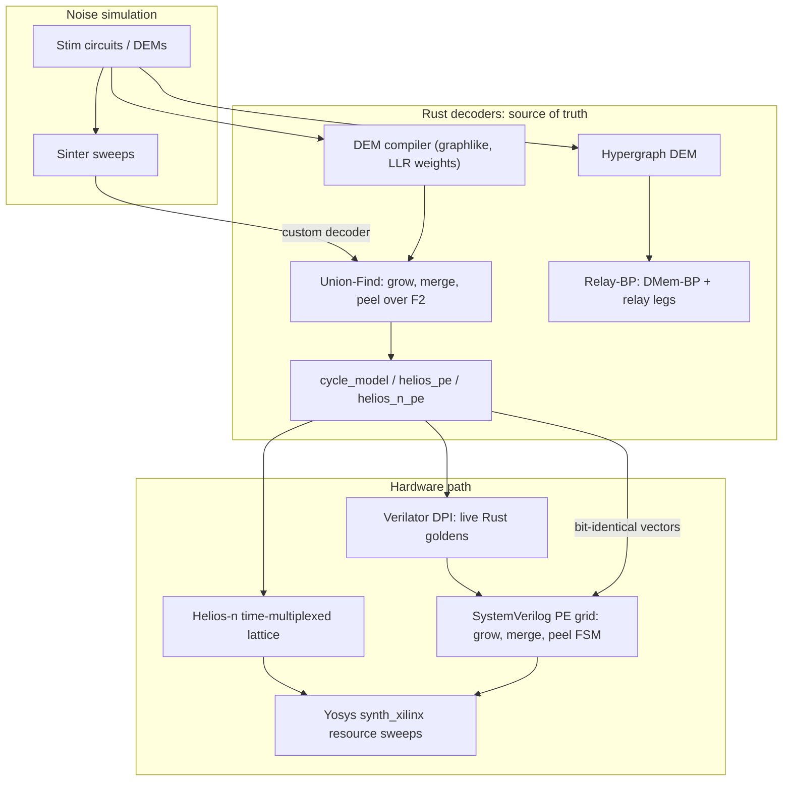

# Aether-Decoders

### Real-time quantum error correction decoding, from proof-checked software to FPGA-ready RTL

**Integer Union-Find** for surface codes &nbsp;·&nbsp; **Relay-BP** for qLDPC codes &nbsp;·&nbsp; **SystemVerilog PE grids** co-simulated bit-for-bit against Rust

---

A fault-tolerant quantum computer has to read out error syndromes, decode them, and send corrections back within a **microsecond-scale budget**, round after round, or the logical qubits are lost. Aether-Decoders builds that decoder end to end:

1. **Software first.** A correct integer Union-Find decoder and a Relay-BP decoder in Rust, benchmarked on Stim circuits against PyMatching and BP+OSD.
2. **Then hardware.** The same algorithms as SystemVerilog processing-element (PE) grids, checked against the Rust model **bit for bit**, in the style of the Helios FPGA decoder.
3. **Then silicon budgets.** Yosys resource sweeps from single PEs up to Stim-scale graphs, and a time-multiplexed **Helios-n** design for graphs that are too large to fit flat.

Every claim in this repository is tied to a test, a co-simulation log, or a CSV in [`results/`](results), and every milestone is recorded in [`Docs/Progress`](Docs/Progress).

| 76 | 28 | 46 | 29 + 29 | 54 |
|:-:|:-:|:-:|:-:|:-:|
| **milestones** | **Rust tests** | **result CSVs** | **RTL modules + testbenches** | **research notes** |

## Contents

- [Architecture](#architecture)
- [Design rules](#design-rules)
- [Results](#results)

## Architecture

| Layer | What it is | Where |
|---|---|---|
| **UF core** | Flat struct-of-arrays graph, DSU with union-by-size, discrete cluster growth, peeling over F2. No `petgraph`. | `src/{graph,dsu,engine,peeling,weights}.rs` |
| **Stim pipeline** | DEM to UF graph compiler, persistent `decode_shots` process, Sinter custom decoder, threshold sweeps vs PyMatching | `src/compiled.rs`, `python/aether_decoders/`, `scripts/threshold_sweep.py` |
| **Relay-BP** | Min-sum DMem-BP with per-node (possibly negative) memory strength and relay legs, after Müller et al. | `src/relay_bp.rs`, `src/relay_compiled.rs` |
| **Cycle models** | Cycle-accurate UF model plus Helios-style PE and Helios-n multiplexed PE models used as RTL oracles | `src/{cycle_model,helios_pe,helios_n_pe}.rs` |
| **RTL** | Grow/merge, OR-tree, per-PE mesh, LUTRAM dual context, multi-cycle peel FSM, syndrome ring, observable egress, Helios-n lattice | `rtl/` |
| **Co-sim** | Icarus and Verilator testbenches fed by generated vectors, plus a Verilator DPI bridge that calls Rust live | `rtl/tb_*.sv`, `dpi/`, `scripts/*_sim.sh` |
| **FPGA prep** | Staged S0 to S4 Yosys `synth_xilinx` runs, bring-up gates, Vivado S0 Tcl/XDC | `fpga/`, `Docs/Fpga_Bringup_Prep` |

## Design rules

These were each learned from a measured bug or mismatch, and they are kept identical in software and RTL. They are not simplified for hardware.

- **Active cluster** = odd defect parity **and** not touching a virtual boundary.
- **Peel from the frozen `syndrome[]`**, never from DSU-mutated parity.
- **Union-by-size**, and skip growth along edges whose endpoints already share a root.
- **One unique virtual boundary vertex per degree-1 DEM error**, so opposite boundaries never get stitched together.
- **Root a boundary-touching cluster at one boundary** and peel every other leaf, including extra virtual boundaries.
- **Circuit Y-faults** stay as `^`-separated pieces and are split, so every piece is degree 2 or less.

The full list of corrected mistakes, with the evidence for each, is in the *Mistakes and corrections* table of [`Docs/Progress`](Docs/Progress).

## Results

All numbers below are copied from CSVs in [`results/`](results). Logical error rates come with shot counts, and decoder comparisons are only made on matched shots with **Wilson 95% intervals**. No threshold is fitted.

### Surface code: Union-Find vs MWPM (M12)

Circuit-level `rotated_memory_z`, rounds = d, 1200 matched shots per row, Stim depolarizing noise on gates, data, measurement and reset. Source: [`threshold_circuit_m12.csv`](results/threshold_circuit_m12.csv).

| d | p | UF errors / LER [95% CI] | PyMatching errors / LER [95% CI] |
|:-:|:-:|---|---|
| 3 | 0.003 | 13 / 0.0108 [0.0063, 0.0185] | 10 / 0.0083 [0.0045, 0.0153] |
| 5 | 0.003 | 5 / 0.0042 [0.0018, 0.0097] | 6 / 0.0050 [0.0023, 0.0109] |
| 7 | 0.003 | 1 / 0.0008 [0.0001, 0.0047] | 1 / 0.0008 [0.0001, 0.0047] |
| 3 | 0.006 | 33 / 0.0275 [0.0197, 0.0384] | 17 / 0.0142 [0.0089, 0.0226] |
| 7 | 0.006 | 20 / 0.0167 [0.0108, 0.0256] | 26 / 0.0217 [0.0148, 0.0316] |

At p = 0.003, the UF intervals for d = 7 and d = 3 are **disjoint**, so distance suppression is visible at that point. UF tracks MWPM closely, which is the expected heuristic gap. The phenomenological grid after the M10 peel fix is in [`threshold_phenom_m10.csv`](results/threshold_phenom_m10.csv). Across 12 × 400 shots up to d = 7, UF finished every decode with **0 aborts** (M51, M54).

### qLDPC: Relay-BP vs BP+OSD on IBM gross `[[144,12,12]]`

The comparison is against `ldpc` BP+OSD-CS10 on IBM's published bivariate-bicycle Stim circuits (d = 12, 12 rounds).

| Run | p | Shots | Relay-BP errors | BP+OSD errors | Wilson verdict |
|---|:-:|:-:|:-:|:-:|---|
| M21 | 0.006 | 50 | 26 | 30 | overlap |
| M27 (seed 1) | 0.005 | 400 | 72 | 115 | disjoint |
| M29 (seed 2) | 0.005 | 400 | 92 | 115 | overlap |
| M76 pooled (M27 + M29) | 0.005 | 800 | 164 | 230 | disjoint |

Relay-BP has fewer errors at every matched point, but the intervals separate at **one** p only, and the BP+OSD count was identical in both seeds. That should be re-run before the pooled result is cited. Gains are problem-dependent, as Müller et al. note.

### Hardware co-simulation: RTL ≡ Rust, bit for bit

| Milestone | Graph | Check | Result |
|---|---|---|:-:|
| M19 | 8 Blueprint graphs | grow → merge → peel RTL vs `decode_cosim` | **8/8** |
| M22 / M45 | phenom d=3 r=3, V=72 E=94 | Stim shots, PE-mesh grow → peel | **4/4** |
| M23 | phenom d=5 r=5, V=272 E=518 | Icarus + Verilator | **2/2 + 2/2** |
| M24 / M47 | circuit d=3 r=3, V=392 E=556 | PE-mesh grow → peel, Verilator | **2/2** |
| M26 / M28 | Blueprint and V=392 | Verilator DPI calling live Rust goldens | **8/8, 2/2** |
| M53 | phenom Stim | syndrome ring → peel → observable XOR egress | **4/4** |
| M72 | phenom r=3, Helios-n 16 parts / 7 PEs | multiplexed Stage D peel vs `decode_cosim` | **16/16** |
| M74 | same map, SystemVerilog schedule RTL | grow → peel vs Helios-n oracle (3 425 380 clk, 34 clk/iter) | **16/16** |
| M76 | circuit V=392, 165 parts / 16 PEs | Helios-n map vs oracle | **16/16** |

### FPGA resources (Yosys `synth_xilinx`, pre place-and-route)

| Design | LUT | FF | Notes |
|---|--:|--:|---|
| OR-tree (S0) | 14 | | M56 |
| H10 syndrome ring (S0) | 30 | 42 | M56 |
| Helios-2 micro PE (S2) | 410 | | M58, BRAM = 0 |
| Multi-cycle peel FSM | 9 453 | 1 405 | M60 |
| S1 Blueprint grow → peel | 13 364 | 1 618 | M62 |
| Peel N=16 | 18 023 | 9 509 | M63 |
| Flat grow N=16 | 138 502 | | M66, last size that finishes |
| S3 phenom grow → peel (V=16) | 153 509 | 10 284 | M64 |
| Flat grow N=24 / N=32 / V=392 | timeout | | M65, M66: the flat-mesh cliff |
| Observable egress (synthesizable) | 3 645 | | M75 |
| **Helios-n lattice, N_PHYS = 7** | **12 576** | **384** | **M74**, plus 180 RAM32M16 |

The flat PE mesh stops synthesizing past N = 16, which is why the project moved to **Helios-n** time multiplexing (M67 to M76). These are Yosys estimates. Vivado utilization and timing on the target part are the next milestone.
