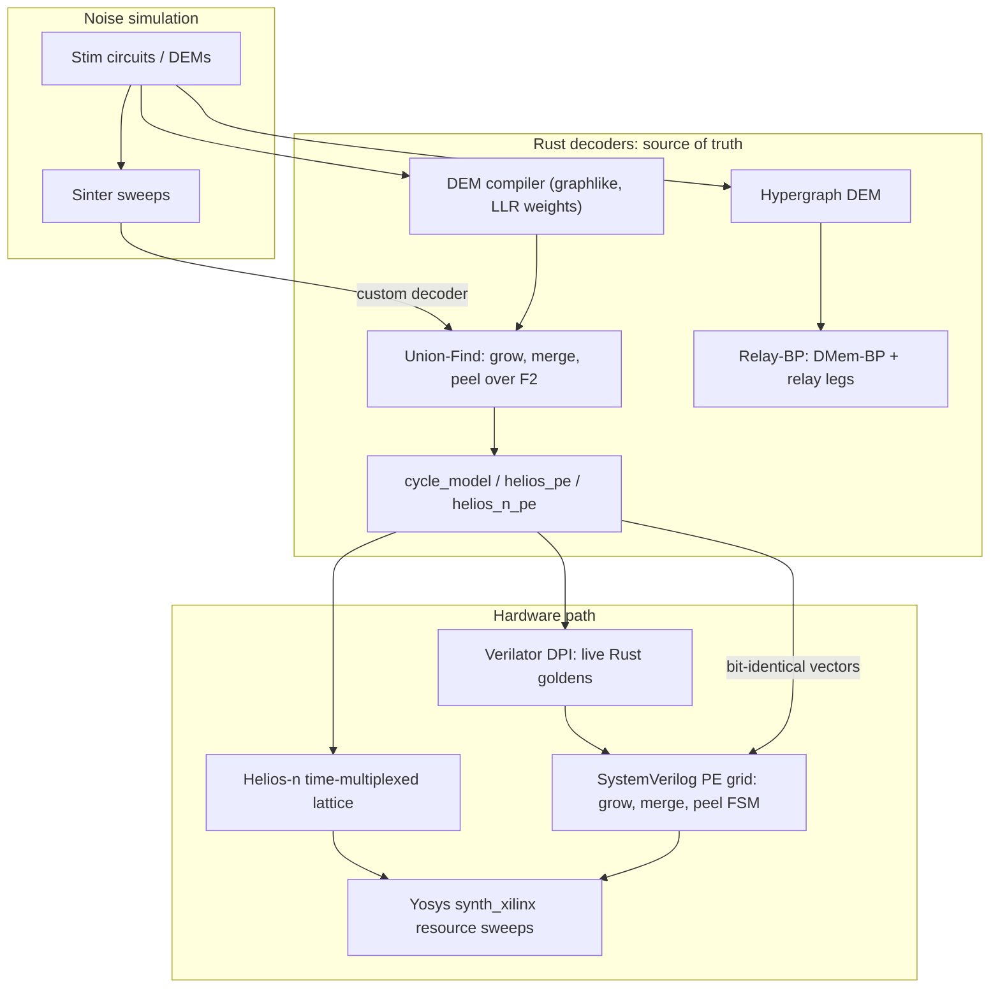

# Aether-Decoders

### Real-time quantum error correction decoding, from proof-checked software to FPGA-ready RTL

**Integer Union-Find** for surface codes &nbsp;·&nbsp; **Relay-BP** for qLDPC codes &nbsp;·&nbsp; **SystemVerilog PE grids** co-simulated bit-for-bit against Rust

---

A fault-tolerant quantum computer has to read out error syndromes, decode them, and send corrections back within a **microsecond-scale budget**, round after round, or the logical qubits are lost. Aether-Decoders builds that decoder end to end:

1. **Software first.** A correct integer Union-Find decoder and a Relay-BP decoder in Rust, benchmarked on Stim circuits against PyMatching and BP+OSD.
2. **Then hardware.** The same algorithms as SystemVerilog processing-element (PE) grids, checked against the Rust model **bit for bit**, in the style of the Helios FPGA decoder.
3. **Then silicon budgets.** Yosys resource sweeps from single PEs up to Stim-scale graphs, and a time-multiplexed **Helios-n** design for graphs that are too large to fit flat.

Every claim in this repository is tied to a test, a co-simulation log, or a CSV in [`results/`](results), and every milestone is recorded in [`Docs/Progress`](Docs/Progress).

| 76 | 28 | 46 | 29 + 29 | 54 |
|:-:|:-:|:-:|:-:|:-:|
| **milestones** | **Rust tests** | **result CSVs** | **RTL modules + testbenches** | **research notes** |

## Contents

- [Architecture](#architecture)
- [Design rules](#design-rules)

## Architecture

| Layer | What it is | Where |
|---|---|---|
| **UF core** | Flat struct-of-arrays graph, DSU with union-by-size, discrete cluster growth, peeling over F2. No `petgraph`. | `src/{graph,dsu,engine,peeling,weights}.rs` |
| **Stim pipeline** | DEM to UF graph compiler, persistent `decode_shots` process, Sinter custom decoder, threshold sweeps vs PyMatching | `src/compiled.rs`, `python/aether_decoders/`, `scripts/threshold_sweep.py` |
| **Relay-BP** | Min-sum DMem-BP with per-node (possibly negative) memory strength and relay legs, after Müller et al. | `src/relay_bp.rs`, `src/relay_compiled.rs` |
| **Cycle models** | Cycle-accurate UF model plus Helios-style PE and Helios-n multiplexed PE models used as RTL oracles | `src/{cycle_model,helios_pe,helios_n_pe}.rs` |
| **RTL** | Grow/merge, OR-tree, per-PE mesh, LUTRAM dual context, multi-cycle peel FSM, syndrome ring, observable egress, Helios-n lattice | `rtl/` |
| **Co-sim** | Icarus and Verilator testbenches fed by generated vectors, plus a Verilator DPI bridge that calls Rust live | `rtl/tb_*.sv`, `dpi/`, `scripts/*_sim.sh` |
| **FPGA prep** | Staged S0 to S4 Yosys `synth_xilinx` runs, bring-up gates, Vivado S0 Tcl/XDC | `fpga/`, `Docs/Fpga_Bringup_Prep` |

## Design rules

These were each learned from a measured bug or mismatch, and they are kept identical in software and RTL. They are not simplified for hardware.

- **Active cluster** = odd defect parity **and** not touching a virtual boundary.
- **Peel from the frozen `syndrome[]`**, never from DSU-mutated parity.
- **Union-by-size**, and skip growth along edges whose endpoints already share a root.
- **One unique virtual boundary vertex per degree-1 DEM error**, so opposite boundaries never get stitched together.
- **Root a boundary-touching cluster at one boundary** and peel every other leaf, including extra virtual boundaries.
- **Circuit Y-faults** stay as `^`-separated pieces and are split, so every piece is degree 2 or less.

The full list of corrected mistakes, with the evidence for each, is in the *Mistakes and corrections* table of [`Docs/Progress`](Docs/Progress).
